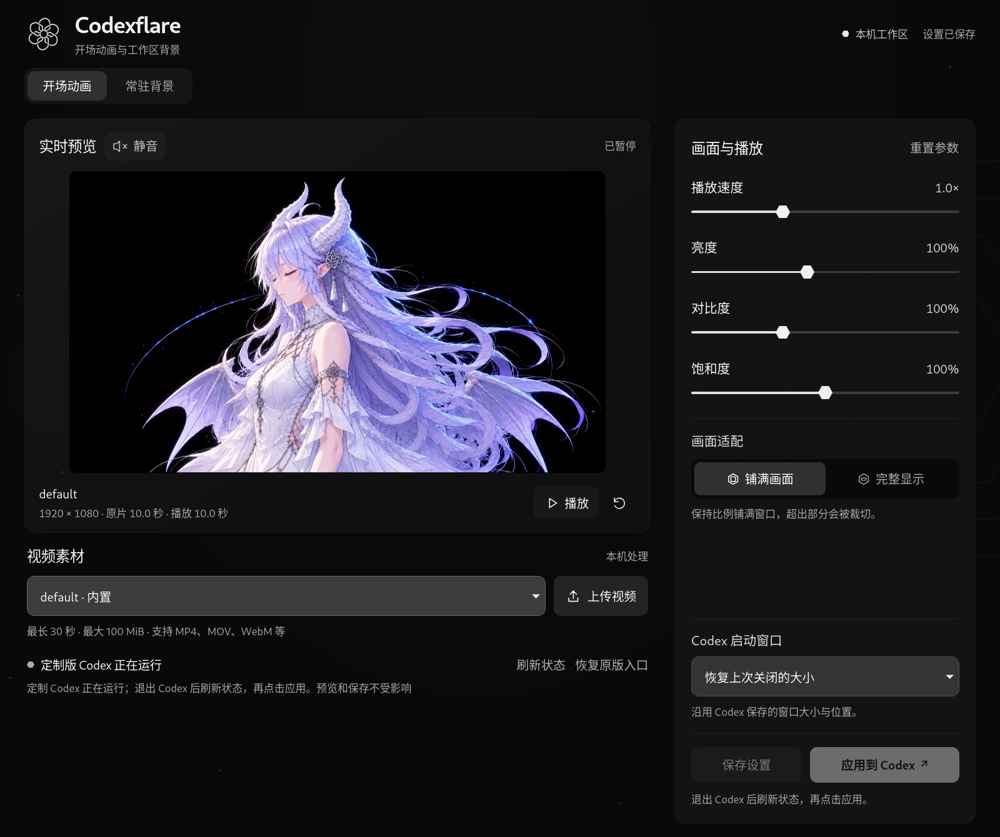
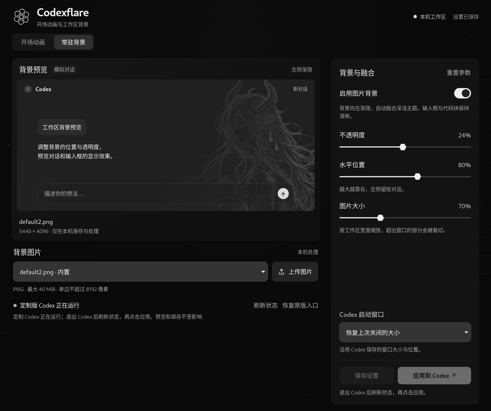
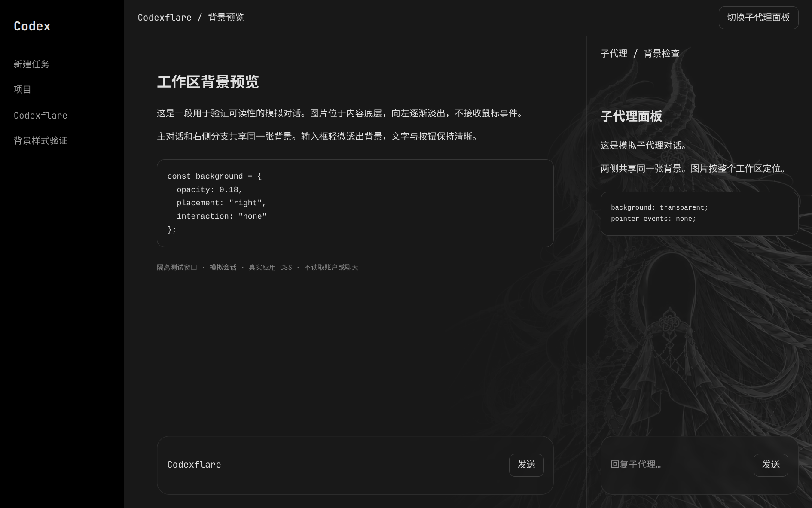

<p align="center">
  
</p>

<h1 align="center">Codexflare</h1>

<p align="center">Customize Codex startup animations, workspace backgrounds and window modes.<br>Linux · macOS · Windows</p>

<p align="center"><a href="README.md">简体中文</a> · <strong>English</strong></p>

<p align="center">
  <a href="https://github.com/epsilon10111/Codexflare/releases/latest">Download</a> ·
  <a href="docs/guide.en.md">User guide</a> ·
  <a href="docs/guide.en.md#development">Contribute</a>
</p>

## A look inside

### Video editor

Preview speed, brightness, contrast, saturation and sound.

<a href="docs/images/animation-editor.png"></a>

### Background editor

Choose a built-in image or import a PNG. Set opacity, position and size.

<a href="docs/images/background-editor.png"></a>

### Startup animation

The workspace loads during playback. Press Esc to skip.

<a href="docs/images/startup-preview.png"></a>

### Workspace background

A gentle fade to the left, shared across the conversation and side panel.

<a href="docs/images/workspace-preview.png"></a>

<sub>Click an image for full size. The editor and startup images are actual captures. The workspace example uses real app CSS and simulated conversations, with no private chats.</sub>

Launch **fullscreen, at the previous window size, or in a centered window**. One video and two backgrounds are included. Media stays on your computer, and applied changes can be rolled back.

## Download and install

Patching requires one of the exact Codex builds below. Other versions can preview and save settings, but cannot apply them. Install Codex separately first.

| Platform | Codex version / build | Get started |
| --- | --- | --- |
| Linux x86_64 | `26.1002.52244 / 13536` | [RPM](https://github.com/epsilon10111/Codexflare/releases/download/v0.1.0/codexflare-0.1.0-1.noarch.rpm) · [DEB](https://github.com/epsilon10111/Codexflare/releases/download/v0.1.0/codexflare_0.1.0-1_all.deb) |
| macOS Apple Silicon | `26.1021.31345 / 21828` | [Run from source](docs/guide.en.md#macos) |
| Windows x64 | `26.1002.52244 / 13536` | [Run from source](docs/guide.en.md#windows) |

Linux expects Codex at `/usr/lib/chatgpt`; Windows targets MSIX `26.1002.7124.0`. The RPM targets Fedora, and the DEB targets Debian 12+ / Ubuntu 24.04+.

<details>
<summary><strong>Quick install on Linux</strong></summary>

Download the matching package, then use one set of commands:

```bash
# Fedora
sudo dnf install ./codexflare-0.1.0-1.noarch.rpm
codexflare
```

```bash
# Debian / Ubuntu
sudo apt install ./codexflare_0.1.0-1_all.deb
codexflare
```

You can also open Codexflare from the application menu. These initial packages are unsigned; see the [installation guide](docs/guide.en.md#linux) for checksums, dependencies and removal.

</details>

## Three steps to your setup

1. **Choose your media.** Pick a bundled video and background, or import your own files.
2. **Adjust and save.** Preview the result, choose a window mode, then click Save settings (保存设置).
3. **Apply to Codex.** Quit Codex, refresh its status and apply. On Linux, use the original menu entry; on macOS and Windows, use the new Codexflare entry.

Reapply after saving to update the customized copy. A startup video cannot guarantee that all network and initialization delays are hidden.

**macOS and Windows use separate login data, so you may need to sign in again.** macOS uses an ad-hoc signature; the Windows copy loses its vendor signature. Some native services or signature policies may restrict the copy. See the [platform notes](docs/guide.en.md).

## Documentation and licensing

[Settings and media](docs/guide.en.md#settings) · [Data and removal](docs/guide.en.md#uninstall) · [Development and builds](docs/guide.en.md#development) · [Validation record, Chinese](VALIDATION.md)

Code is licensed under [MIT](LICENSE). Bundled videos, images and media shown in screenshots are distributed with Codexflare under a [separate media license](assets/LICENSE).

An unofficial project, not affiliated with or endorsed by OpenAI. Releases do not include Codex, ChatGPT or Electron binaries.
