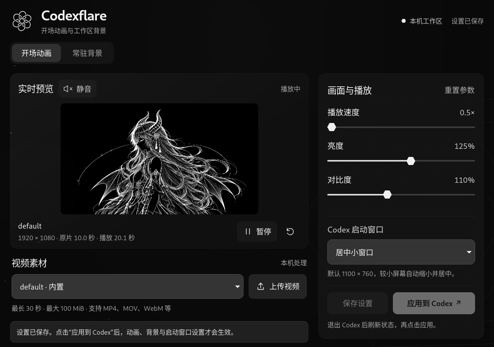

# Codexflare

> **Windows 适配分支：`feat/windows-support`**。支持 Windows x64 Codex `26.1002.52244 / build 13536`（Microsoft Store 包 `26.1002.7124.0`），使用原生 WebView2 编辑窗口及独立开始菜单入口。安装、使用和验证边界见 **[Windows 指南](WINDOWS.md)**。下方原有 RPM 说明适用于 Linux；macOS 适配保留在 `feat/macos-support`。

**为 Linux Codex 桌面版定制开场动画与工作区背景。**

Codexflare 是一个轻量级本地外观编辑器：在独立桌面窗口中选择视频和图片，调整画面，再应用到可回退的 Codex 副本。使用系统 GTK / WebKit，无需浏览器标签页或额外 Electron 运行时。

[下载 Release](https://github.com/epsilon10111/Codexflare/releases/latest) · [验收记录](VALIDATION.md) · [贡献指南](AGENTS.md) · [代码许可](LICENSE) · [素材许可](assets/LICENSE)



## 功能

- **开场视频**：内置约十秒动画，支持导入视频；调节速度、亮度、对比度、饱和度和画面适配，切换静音或声音开启。
- **常驻背景**：两张内置背景，也可上传 PNG；调整不透明度、水平位置和大小，向左渐隐，主对话与右侧分支共享背景。
- **启动窗口**：保存全屏、恢复上次窗口，或居中小窗口三种启动方式。
- **启动衔接**：视频播放期间并行准备工作区与背景；支持 Esc 跳过、播放失败退出和减少动态效果偏好。
- **本地与可回退**：素材在本机处理，配置和素材不上传；仅修改本地应用副本及用户菜单入口，可恢复原入口。

## 兼容范围

目前仅支持 **Codex 26.1002.52244 / build 13536 / Linux x86_64**，原应用位于 `/usr/lib/chatgpt`。已在 Fedora KDE / Wayland（通过 XWayland）验证。其他构建可使用编辑器预览和保存，但不能应用补丁；Windows、macOS 与其他 Linux 桌面未验证。

这是独立的非官方项目，与 OpenAI 无隶属或背书关系。发布包不包含 Codex、ChatGPT 或 Electron 的程序文件，需要自行安装兼容的 Codex。创建本地副本需要约 **1.6 GB** 额外空间。

## 安装与使用

### Fedora RPM

从 [最新 Release](https://github.com/epsilon10111/Codexflare/releases/latest) 下载 RPM 和 `SHA256SUMS`，在下载目录执行：

```bash
sha256sum --ignore-missing -c SHA256SUMS
sudo dnf install ./codexflare-0.1.0-1.noarch.rpm
codexflare
```

也可从应用菜单打开 **Codexflare**。RPM 标为 `noarch`，表示编辑器代码不含本机二进制；可应用补丁的 Codex 仍仅限上述 x86_64 构建。安装 RPM 本身不会修改 Codex。

RPM 安装 Python 3.11+、PyGObject、GTK 3、WebKit2 4.1 和 GStreamer 基础媒体组件。默认素材可直接播放；导入视频还需要提供 `ffmpeg`、`ffprobe` 及 `libvpx-vp9`、`libopus` 编码器的 FFmpeg。RPM 推荐安装 `ffmpeg-free`，实际编码支持取决于发行版的软件包。

### 从源码运行

```bash
git clone https://github.com/epsilon10111/Codexflare.git
cd Codexflare
python3 tools/editor.py
```

源码运行同样需要上述桌面依赖，无 npm 构建步骤。若当前 Python 缺少 GI，启动器会尝试 `/usr/bin/python3`。编辑器在本地窗口运行，内部服务仅监听 `127.0.0.1`，关闭窗口后结束。

### 应用设置

1. 在「开场动画」选择视频，或在「常驻背景」选择、上传图片。
2. 调节预览参数与「Codex 启动窗口」，点击「保存设置」。
3. **完全退出 Codex**，在仍然打开的 Codexflare 中点击「刷新状态」，再点击「应用到 Codex」。仅关闭窗口可能仍留在托盘。
4. 从原来的 ChatGPT / Codex 菜单入口重新启动。

保存设置不会更新已安装的副本，需重新应用。工具拒绝覆盖正在运行的定制副本，也不会关闭你的会话。唤起已有实例时不重复播放或调整窗口。

## 参数与素材

| 类别 | 可调内容 |
| --- | --- |
| 视频 | 速度 0.5–2×，亮度 25–200%，对比度 50–200%，饱和度 0–200% |
| 播放 | 铺满裁切 / 完整显示；静音（默认）/ 声音开启 |
| 背景 | 不透明度 0–50%（默认 18%），水平位置 50–100%（默认 80%），宽度 40–140%（默认 70%） |
| 启动窗口 | 恢复上次大小、位置及最大化状态（默认）；全屏；居中 1100×760 逻辑像素，小屏自动缩小 |

视频导入上限 **100 MiB / 30 秒**，支持的输入格式取决于 FFmpeg。导入后转换为不超过 1920×1080、30 fps 的 VP9 WebM，有音轨时保留为 Opus；原片不变。没有音轨的视频无法发声。

背景支持 **PNG，最大 40 MiB，单边不超过 8192 像素、总计不超过 6400 万像素**。内置 `default1.png` 和 `default2.png`，默认选中第一张。应用时仅将运行副本中的大图缩至 3840×2160 范围，保留原图与透明度；缺少 FFmpeg 时使用原尺寸。

背景样式适合黑底线条素材：深色主题使用滤色融合，浅色主题反相后混合，普通照片可能改变观感。窄窗口进一步淡化，高对比度或减少透明效果偏好会隐藏背景。关闭「启用图片背景」并重新应用即可单独撤回背景。

开场结束时，已准备好的工作区直接淡入；若仍在初始化，最多保留尾帧等待 20 秒。Esc、播放失败或超时均释放遮罩。网络和后端初始化仍可能慢于视频，不能保证任意视频长度都能覆盖实际加载时间。

## 配置、管理与卸载

| 安装方式 | 配置、导入素材、运行副本与备份 |
| --- | --- |
| RPM | `${XDG_DATA_HOME:-~/.local/share}/codexflare/` |
| 源码 | 仓库内 `.local/` |

目录内 `animation.json` 保存设置，`media/` 与 `backgrounds/` 保存导入素材，`runtime/` 保存定制副本。两种安装方式的数据独立；切换方式前先恢复原菜单入口。源码方式启用期间不要移动或删除仓库。

```bash
codexflare-manage status      # 检查副本与菜单入口
codexflare-manage install     # 使用已保存设置生成并启用副本
codexflare-manage launch      # 启动副本，来源变化时回退原版
codexflare-manage uninstall   # 恢复原菜单入口，保留配置、素材和备份
```

源码方式将 `codexflare-manage` 替换为 `python3 tools/manage.py`。

工具不改写 `/usr/lib/chatgpt`、`/usr/bin/chatgpt` 或用户登录、聊天数据。仅更新用户级 `chatgpt.desktop`，备份原入口；检测到入口被其他操作改写时拒绝覆盖。系统 Codex 更新后会回退原版，待新版本重新适配。

卸载 RPM 前，先恢复入口：

```bash
codexflare-manage uninstall
sudo dnf remove codexflare
```

卸载不会删除个人素材、配置和副本，也不停止运行中的进程。若先移除 RPM，保留在用户数据目录中的 `launch.py` 会将原菜单入口回退到系统 Codex。

## 开发与验证

```text
ui/          GTK/WebKit 编辑器的页面、样式与标志
src/         注入 Codex 的动画与背景样式
tools/       配置、素材处理、补丁、安装与验证工具
tests/       Python / Node 回归测试及原生探针
assets/      默认视频、背景和素材许可
packaging/   RPM 打包文件
docs/        文档图片
```

```bash
python3 -m unittest discover -s tests -v
node --test tests/test_boot.cjs tests/test_editor_ui.cjs tests/test_window_mode.cjs
/usr/bin/python3 tools/desktop_smoke.py
python3 tools/background_smoke.py --startup
python3 tools/native_smoke.py
```

原生测试会短暂打开隔离窗口，不读取真实账户或退出当前会话。桌面测试需要具备 GTK / WebKit 的系统 Python；背景与完整应用测试需要已安装副本，也可用 `--runtime /绝对路径/runtime` 指定候选副本。测试输出留在忽略的 `work/` 目录。

当前已验证编辑器、视频播放、背景融合、窗口模式及模拟工作区片尾衔接。**隔离登录页和模拟工作区不代表真实账户冷启动验收**；真实账户恢复、其他构建和长期运行仍需验证。详细证据与失败边界见 [VALIDATION.md](VALIDATION.md)，界面原则见 [DESIGN.md](DESIGN.md)。

### 构建 Release

安装 `rpm-build` 和 `desktop-file-utils` 后，在源码目录执行（默认打包已提交的 `HEAD`，不包含未提交修改）：

```bash
python3 tools/build_rpm.py
# 或重建指定版本：python3 tools/build_rpm.py --ref v0.1.0
```

`dist/` 输出 RPM、源码归档、SRPM 与 `SHA256SUMS`。RPM 仅携带运行所需代码、UI、`default.webm` 及两张内置背景；原始 MP4、旧版光轨示例和开发工具保留在源码发行包。构建不包含系统 Codex、用户配置、测试 profile 或 `work/` 产物。

首版 RPM 未作 GPG 签名，`SHA256SUMS` 用于校验下载完整性。可执行 `python3 tools/rpm_smoke.py dist/codexflare-0.1.0-1.noarch.rpm` 在隔离目录检查包内容和配置读写。

问题反馈请注明 Codex 版本、Linux 发行版、桌面环境和复现步骤，避免附带登录数据或私人聊天。代码贡献规范见 [AGENTS.md](AGENTS.md)。

## 许可与来源

- **代码与文档文字：MIT**，见 [LICENSE](LICENSE)。
- **内置媒体：保留权利，按单独许可分发**，见 [assets/LICENSE](assets/LICENSE)。允许随 Codexflare 源码、RPM 及修改版分发，并进行应用所需的转码与缩放；不授予独立销售素材或发布到外部素材库的许可。仓库内的全部内容并非统一采用 MIT。
- 默认视频和两张背景由项目维护者提供；旧光轨示例由项目脚本生成。默认原片为 `assets/default.mp4`，播放版为 `assets/default.webm`。第三方名称、运行依赖与参考来源见 [THIRD_PARTY_NOTICES.md](THIRD_PARTY_NOTICES.md)。
