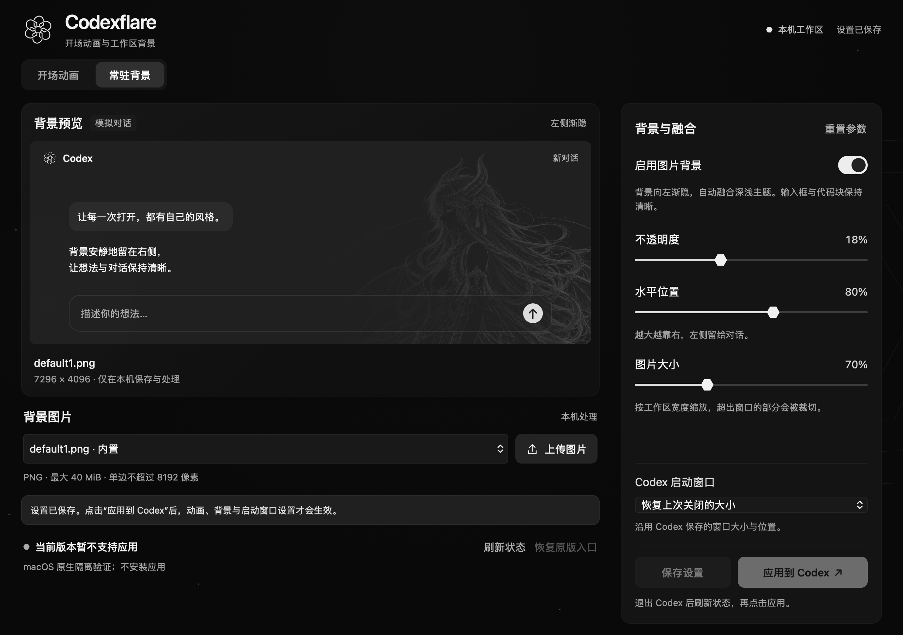
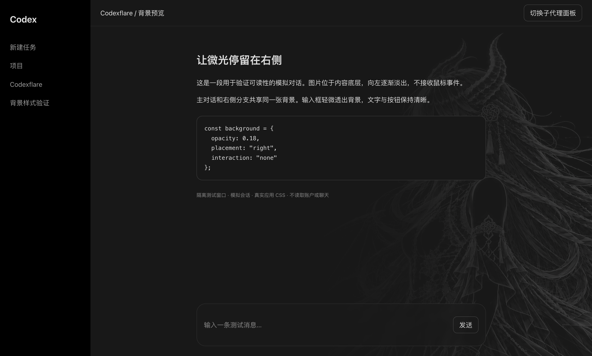

# Codexflare

**为 Linux 与 macOS Codex 桌面版定制开场动画与工作区背景。**

Codexflare 是一个轻量级本地外观编辑器：在独立桌面窗口中选择视频和图片，调整画面，再应用到可回退的 Codex。Linux 使用 GTK / WebKit，macOS 使用 Cocoa / WKWebView；无需浏览器标签页或额外 Electron 运行时。

[macOS v0.1.1](https://github.com/epsilon10111/Codexflare/releases/tag/v0.1.1) · [Linux v0.1.0](https://github.com/epsilon10111/Codexflare/releases/tag/v0.1.0) · [验收记录](VALIDATION.md) · [贡献指南](AGENTS.md) · [代码许可](LICENSE) · [素材许可](assets/LICENSE)

**v0.1.1 是 `release/macos-build20586` 分支的 macOS 定向发布**，基于 `25f3b0c`，仅适配下述 build 20586；不替代 `main` 的其他平台或构建适配，也不变更 v0.1.0 的 Linux 发布。


## 功能

- **开场视频**：内置约十秒动画，支持导入视频；调节速度、亮度、对比度、饱和度和画面适配，切换静音或声音开启。
- **常驻背景**：两张内置背景，也可上传 PNG；调整不透明度、水平位置和大小，向左渐隐，主对话与右侧分支共享背景。
- **启动窗口**：保存全屏、恢复上次窗口，或居中小窗口三种启动方式。
- **启动衔接**：视频播放期间并行准备工作区与背景；支持 Esc 跳过、播放失败退出和减少动态效果偏好。
- **本地与可回退**：素材在本机处理，配置和素材不上传；支持定制副本，以及保留官方备份的 macOS 原入口模式。

## 兼容范围

各发布版本的补丁严格限定以下构建，其他版本可预览、保存，但不能应用：

| 发布 | 平台 | Codex 版本 / build | 原应用 |
| --- | --- | --- | --- |
| v0.1.1 | macOS Apple Silicon（arm64） | 26.1013.31256 / 20586 | `/Applications/Codex.app` 或 `/Applications/ChatGPT.app` |
| v0.1.0 | Linux x86_64 | 26.1002.52244 / 13536 | `/usr/lib/chatgpt` |

v0.1.1 的 macOS 动画与编辑器已在 **macOS 26.6.2** 验证；yabai 等平铺窗口管理器可以覆盖居中/恢复模式的窗口尺寸。Intel / 通用二进制、其他 macOS 版本及其他 Codex 构建不在本次发布的验证范围。Linux v0.1.0 已在 Fedora KDE / Wayland（XWayland）验证。

这是独立的非官方项目，与 OpenAI 无隶属或背书关系。发布包不包含 Codex、ChatGPT 或 Electron 的程序文件，需要自行安装兼容的 Codex。安装时需为完整应用副本预留空间；macOS 原入口模式还会保留官方备份和待安装候选。

## 安装与使用

### macOS（v0.1.1 DMG）

从 [v0.1.1 Release](https://github.com/epsilon10111/Codexflare/releases/tag/v0.1.1) 下载 `Codexflare-0.1.1-macOS-arm64-build20586.dmg` 和同名 `.sha256` 文件，在下载目录校验：

```bash
shasum -a 256 -c Codexflare-0.1.1-macOS-arm64-build20586.dmg.sha256
```

将 `Codexflare.app` 拖到 **Applications** 后，从“应用程序”运行；不要直接在只读 DMG 中运行。包内包含 Python / PyObjC，**默认使用原入口模式**，数据保存在 `~/.local/share/codexflare`。如果曾用源码版的原入口模式修改 ChatGPT，先在旧编辑器恢复原版 ChatGPT，彻底退出并等恢复完成，再使用 DMG 版；不要搬运旧状态文件或官方备份。只使用过源码独立副本模式的用户无需恢复原应用。

DMG 不内嵌 FFmpeg；默认动画及两张已缩图的背景可直接使用。导入自定义视频或对新图片进一步缩图需另装 FFmpeg / ffprobe。已安装 Homebrew 的用户可执行 [`brew install ffmpeg`](https://formulae.brew.sh/formula/ffmpeg)，否则参考 [FFmpeg 官方下载页](https://ffmpeg.org/download.html)，安装后重新打开 Codexflare。

在 **系统设置 → 隐私与安全性 → App 管理** 中，授权实际发起修改的 App：通过 ChatGPT 任务执行时授权 **ChatGPT**；独立运行打包版时授权 **Codexflare**，以系统弹窗显示的名称为准。Apple 将此权限用于更新或删除其他 App；它与“自动化”“完全磁盘访问权限”不同，无需为此开启完全磁盘访问或关闭系统安全保护。[Apple 权限说明](https://support.apple.com/zh-cn/guide/mac-help/mchl211c911f/26/mac/26)

此包使用 ad-hoc 签名，没有 Developer ID 签名或 Apple 公证。首次打开的系统提示、原入口与独立副本区别、等待退出安装及恢复方法，见 DMG 内的[安装说明](packaging/macos/安装说明.txt)。

### macOS（源码运行）

需要 Python 3.11+、Apple Command Line Tools（`codesign` / `lipo`）和 PyObjC；导入视频还需 FFmpeg。使用较短路径避免 macOS Unix socket 路径超长。已安装 `uv` 时：

```bash
mkdir -p "$HOME/Applications"
git clone --branch v0.1.1 https://github.com/epsilon10111/Codexflare.git "$HOME/Applications/Codexflare"
cd "$HOME/Applications/Codexflare"
uv venv --python python3 .venv
uv pip install --python .venv/bin/python -r requirements-macos.txt
.venv/bin/python tools/editor.py
```

没有 `uv` 时可使用 `python3 -m venv .venv` 和 `.venv/bin/python -m pip install -r requirements-macos.txt`。系统自带的旧版 `/usr/bin/python3` 不满足 Python 3.11 要求。源码版默认使用独立副本模式，配置保存在仓库内 `.local/`；启用期间不要移动或删除仓库。

#### 原 ChatGPT 入口模式（DMG 默认，源码可显式启用）

源码版首次启用时，在仓库目录运行以下命令；第二条会等待目标应用正常退出，可用 `--relaunch` 在安装后重新打开：

```bash
.venv/bin/python tools/original_macos.py prepare
.venv/bin/python tools/original_macos.py wait-activate --relaunch
```

后续打开编辑器，保存设置并点击「应用到 ChatGPT」。原应用运行期间可以准备设置，状态显示「已准备，等待 ChatGPT 退出」。用 **Cmd+Q 完全退出 ChatGPT** 后，后台安装器才将已验证的候选应用原子替换到原路径；以后仍点击原来的 ChatGPT 图标。目标为 `Codex.app` 时使用对应的 Codex 入口。仅关闭窗口或唤起已有进程不会重播开场。

该模式保留原应用名称、图标、bundle ID、URL 协议及默认配置路径，不创建独立账号目录，也不复制登录或聊天数据。动画、背景及预加载、并行初始化、背景缩图和片尾就绪衔接使用与 Linux 相同的实现；macOS 只适配当前构建的脚本、样式锚点和签名。

官方原包和待安装状态分别保留为数据目录内的 `Original ChatGPT.app` 与 `original-install.json`：DMG 使用 `~/.local/share/codexflare`，源码使用仓库内 `.local/`。编辑器的「恢复原版 ChatGPT」也会等待应用正常退出后恢复。每次安装与恢复都检查备份签名、完整内容摘要及当前原包是否被更新；发现变化时拒绝覆盖。源码状态检查：

```bash
.venv/bin/python tools/original_macos.py status
```

后续由编辑器负责准备和启动后台等待器。没有原入口状态文件的源码检出使用下述独立副本模式。

**保留原入口不等于保留供应商签名。** 修改后的应用使用本地 ad-hoc 签名，不能继承 OpenAI Developer ID、共享 Keychain、通知或原生工具服务身份，可能需要重新登录，签名相关功能可能不可用。隔离动画测试不代表真实账户及这些原生功能已验收。原版更新后需要重新适配，不能直接用旧备份覆盖新版本。

#### 独立副本模式（源码默认）





在原生编辑器保存设置并点击「应用到 Codex」，或直接运行：

```bash
.venv/bin/python tools/manage.py install
open "$HOME/Applications/Codexflare Codex.app"
```

**独立副本模式使用单独的启动入口及应用配置。** 定制副本位于 `.local/Codexflare Runtime.app`；该模式下普通 `/Applications/ChatGPT.app` 或 `Codex.app` 保持原样。动画只在从新入口冷启动副本时播放，唤起已运行窗口不重播。用 Cmd+Q 正常退出副本后，可再次启动观看。原入口模式不使用此独立入口。

副本使用本地 ad-hoc 签名、独立 bundle ID，以及 `.local/profile` / `.local/codex-home`，首次可能需要重新登录。它不能继承 OpenAI 的 Developer ID、共享 Keychain、通知或原生工具服务身份；例如检查签名的电脑控制服务可能拒绝连接。**开屏和编辑器验证不代表这些签名相关功能完整兼容，也不代表真实账户会话已验收。**

默认自动寻找 `/Applications/Codex.app` 或 `/Applications/ChatGPT.app`。自定义位置时，在编辑或管理命令前设置 `CODEXFLARE_SOURCE_APP=/完整路径/Codex.app`，后续保持同一路径。原版更新后，旧副本的启动入口会回退到原版，等待重新适配。

```bash
.venv/bin/python tools/manage.py status
.venv/bin/python tools/manage.py uninstall
```

卸载只移除本工具创建的 `~/Applications/Codexflare Codex.app` 入口，保留副本和设置，不停止进程，也不修改原版或其登录数据。源码目录移动后应重新安装入口。

### Fedora RPM

从 [Linux v0.1.0 Release](https://github.com/epsilon10111/Codexflare/releases/tag/v0.1.0) 下载 RPM 和 `SHA256SUMS`，在下载目录执行：

```bash
sha256sum --ignore-missing -c SHA256SUMS
sudo dnf install ./codexflare-0.1.0-1.noarch.rpm
codexflare
```

也可从应用菜单打开 **Codexflare**。RPM 标为 `noarch`，表示编辑器代码不含本机二进制；可应用补丁的 Codex 仍仅限上述 x86_64 构建。安装 RPM 本身不会修改 Codex。

RPM 安装 Python 3.11+、PyGObject、GTK 3、WebKit2 4.1 和 GStreamer 基础媒体组件。默认素材可直接播放；导入视频还需要提供 `ffmpeg`、`ffprobe` 及 `libvpx-vp9`、`libopus` 编码器的 FFmpeg。RPM 推荐安装 `ffmpeg-free`，实际编码支持取决于发行版的软件包。

### Linux 从源码运行（v0.1.0）

```bash
git clone --branch v0.1.0 https://github.com/epsilon10111/Codexflare.git
cd Codexflare
python3 tools/editor.py
```

Linux 源码运行需要上述 GTK 桌面依赖；macOS 使用上节的 v0.1.1 与 PyObjC 环境。两者均无 npm 构建步骤。Linux 当前 Python 缺少 GI 时，启动器会尝试 `/usr/bin/python3`。编辑器在本地窗口运行，内部服务仅监听 `127.0.0.1`，关闭窗口后结束。

### 应用设置

1. 在「开场动画」选择视频，或在「常驻背景」选择、上传图片。
2. 调节预览参数与「Codex 启动窗口」，点击「保存设置」。
3. Linux 或 macOS 独立副本模式：**完全退出 Codex** 后点击「应用到 Codex」。macOS 原入口模式：直接点击「应用到 ChatGPT」，准备完成后再用 Cmd+Q 退出 ChatGPT，等待后台应用。仅关闭窗口可能仍留有进程。
4. Linux 和 macOS 原入口模式从原图标启动；macOS 独立副本模式从 `~/Applications/Codexflare Codex.app` 启动。

保存设置不会更新已安装的副本，需重新应用。工具拒绝覆盖正在运行的定制副本，也不会关闭你的会话。唤起已有实例时不重复播放或调整窗口。

## 参数与素材

| 类别 | 可调内容 |
| --- | --- |
| 视频 | 速度 0.5–2×，亮度 25–200%，对比度 50–200%，饱和度 0–200% |
| 播放 | 铺满裁切 / 完整显示；静音（默认）/ 声音开启 |
| 背景 | 不透明度 0–50%（默认 18%），水平位置 50–100%（默认 80%），宽度 40–140%（默认 70%） |
| 启动窗口 | 恢复上次大小、位置及最大化状态（默认）；全屏；居中 1100×760 逻辑像素，小屏自动缩小 |

视频导入上限 **100 MiB / 30 秒**，支持的输入格式取决于 FFmpeg。导入后转换为不超过 1920×1080、30 fps 的 VP9 WebM，有音轨时保留为 Opus；原片不变。没有音轨的视频无法发声。

背景支持 **PNG，最大 40 MiB，单边不超过 8192 像素、总计不超过 6400 万像素**。内置 `default1.png` 和 `default2.png`，默认选中第一张。应用时仅将运行副本中的大图缩至 3840×2160 范围，保留原图与透明度；缺少 FFmpeg 时使用原尺寸。

背景样式适合黑底线条素材：深色主题使用滤色融合，浅色主题反相后混合，普通照片可能改变观感。窄窗口进一步淡化，高对比度或减少透明效果偏好会隐藏背景。关闭「启用图片背景」并重新应用即可单独撤回背景。

开场结束时，已准备好的工作区直接淡入；若仍在初始化，最多保留尾帧等待 20 秒。Esc、播放失败或超时均释放遮罩。网络和后端初始化仍可能慢于视频，不能保证任意视频长度都能覆盖实际加载时间。

## 配置、管理与卸载

| 安装方式 | 配置、导入素材、运行副本与备份 |
| --- | --- |
| macOS DMG | `~/.local/share/codexflare/`；设置了绝对路径的 `XDG_DATA_HOME` 时使用其下的 `codexflare/` |
| Linux RPM | `${XDG_DATA_HOME:-~/.local/share}/codexflare/` |
| 源码 | 仓库内 `.local/` |

目录内 `animation.json` 保存设置，`media/` 与 `backgrounds/` 保存导入素材。Linux 定制副本为 `runtime/`，macOS 独立副本为 `Codexflare Runtime.app`；macOS 原入口模式另保留 `Original ChatGPT.app` 官方备份及 `original-install.json` 安装状态。源码与打包版的数据独立，不能直接搬运原入口状态和备份。源码方式启用期间不要移动或删除仓库。

macOS 原入口模式卸载前，在编辑器点击「恢复原版 ChatGPT」，正常退出目标应用并确认恢复完成，再删除 `Codexflare.app`。Linux RPM 的管理命令如下：

```bash
codexflare-manage status      # 检查副本与菜单入口
codexflare-manage install     # 使用已保存设置生成并启用副本
codexflare-manage launch      # 启动副本，来源变化时回退原版
codexflare-manage uninstall   # 恢复原菜单入口，保留配置、素材和备份
```

Linux 源码方式将 `codexflare-manage` 替换为 `python3 tools/manage.py`。macOS 源码的独立副本及原入口命令见上文。

Linux 工具不改写 `/usr/lib/chatgpt`、`/usr/bin/chatgpt` 或用户登录、聊天数据。仅更新用户级 `chatgpt.desktop`，备份原入口；检测到入口被其他操作改写时拒绝覆盖。系统 Codex 更新后会回退原版，待新版本重新适配。

卸载 RPM 前，先恢复入口：

```bash
codexflare-manage uninstall
sudo dnf remove codexflare
```

卸载不会删除个人素材、配置和副本，也不停止运行中的进程。若先移除 RPM，保留在用户数据目录中的 `launch.py` 会将原菜单入口回退到系统 Codex。

## 开发与验证

```text
ui/          GTK/WebKit 与 Cocoa/WKWebView 共用的页面、样式与标志
src/         注入 Codex 的动画与背景样式
tools/       配置、素材处理、补丁、安装与验证工具
tests/       Python / Node 回归测试及原生探针
assets/      默认视频、背景和素材许可
packaging/   RPM 与 macOS DMG 打包文件
docs/        文档图片
```

```bash
python3 -m unittest discover -s tests -v
node --test tests/test_*.cjs
/usr/bin/python3 tools/desktop_smoke.py
python3 tools/background_smoke.py --startup
python3 tools/native_smoke.py
```

原生测试会短暂打开隔离窗口，不读取真实账户或退出当前会话。桌面测试需要具备 GTK / WebKit 的系统 Python；背景与完整应用测试需要已安装副本，也可用 `--runtime /绝对路径/runtime` 指定候选副本。测试输出留在忽略的 `work/` 目录。

当前已验证编辑器、视频播放、背景融合、窗口模式及模拟工作区片尾衔接。**隔离登录页和模拟工作区不代表真实账户冷启动验收**；真实账户恢复、其他构建和长期运行仍需验证。详细证据与失败边界见 [VALIDATION.md](VALIDATION.md)，界面原则见 [DESIGN.md](DESIGN.md)。

### 构建 Release

macOS v0.1.1 从 `release/macos-build20586` 的发布提交构建，使用 Apple Silicon 构建机和干净、已提交的 `HEAD`。`--release` 检查工作树状态，并仅将发布提交的已跟踪文件纳入源码归档；不包含未跟踪文件、官方应用、个人配置或 FFmpeg：

```bash
.venv/bin/python -m pip install -r requirements-build-macos.txt
.venv/bin/python tools/build_dmg.py --release
```

构建阶段需要 PATH 中可用的 FFmpeg 预缩两张默认背景；产物写入 `dist/`，同时生成 SHA-256。DMG 包含独立 Python / PyObjC 运行环境；依赖许可在 `Codexflare.app/Contents/Resources/licenses/`，版本见 DMG 内 `构建信息.json`。脚本检查资源、原入口模式、签名和镜像完整性。发布前应从 DMG 复制到新路径运行 `Codexflare.app/Contents/MacOS/Codexflare --self-check` 及 `--smoke-test --output /临时验证目录`，再检查真实窗口；DOM 存在不代表控件可见。

Linux v0.1.0 的 RPM 可在安装 `rpm-build` 和 `desktop-file-utils` 后，从该版本的源码重建：

```bash
python3 tools/build_rpm.py --ref v0.1.0
```

`dist/` 输出 RPM、源码归档、SRPM 与 `SHA256SUMS`。RPM 仅携带运行所需代码、UI、`default.webm` 及两张内置背景；原始 MP4、旧版光轨示例和开发工具保留在源码发行包。构建不包含系统 Codex、用户配置、测试 profile 或 `work/` 产物。

首版 RPM 未作 GPG 签名，`SHA256SUMS` 用于校验下载完整性。可执行 `python3 tools/rpm_smoke.py dist/codexflare-0.1.0-1.noarch.rpm` 在隔离目录检查包内容和配置读写。

问题反馈请注明 Codex 版本、操作系统版本、CPU 架构和复现步骤；Linux 另附发行版与桌面环境。避免附带登录数据或私人聊天。代码贡献规范见 [AGENTS.md](AGENTS.md)。

## 许可与来源

- **代码与文档文字：MIT**，见 [LICENSE](LICENSE)。
- **内置媒体：保留权利，按单独许可分发**，见 [assets/LICENSE](assets/LICENSE)。允许随 Codexflare 源码、RPM、DMG 及修改版分发，并进行应用所需的转码与缩放；不授予独立销售素材或发布到外部素材库的许可。仓库内的全部内容并非统一采用 MIT。
- 默认视频和两张背景由项目维护者提供；旧光轨示例由项目脚本生成。默认原片为 `assets/default.mp4`，播放版为 `assets/default.webm`。第三方名称、运行依赖与参考来源见 [THIRD_PARTY_NOTICES.md](THIRD_PARTY_NOTICES.md)。

### macOS 原生验证

```bash
.venv/bin/python -m unittest discover -s tests -v
node --test tests/test_*.cjs
.venv/bin/python tools/macos_editor_smoke.py
.venv/bin/python tools/background_smoke.py
.venv/bin/python tools/background_smoke.py --startup
.venv/bin/python tools/native_smoke.py --runtime ".local/Codexflare Runtime.app"
```

测试会短暂显示窗口并自动退出；请不要对测试窗口按 Esc。输出保存在忽略的 `work/` 中。原生应用探针使用独立的 profile、Codex 数据目录和测试 Keychain，不读取或终止正在运行的原版会话。
