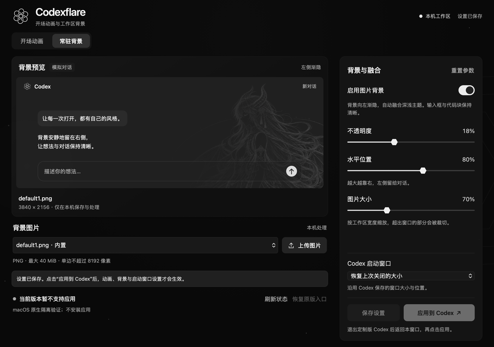

# Codexflare v0.1.1 — macOS build 20586

这是 `release/macos-build20586` 分支的 macOS 定向发布，仅适配 **Apple Silicon（arm64）、Codex 26.1013.31256 / build 20586**，已在 macOS 26.6.2 验证。目标应用为 `/Applications/ChatGPT.app` 或 `/Applications/Codex.app`。本分支基于 `25f3b0c`，不合并或替代 `main` 的其他平台与构建适配。

Linux 用户继续使用 [v0.1.0](https://github.com/epsilon10111/Codexflare/releases/tag/v0.1.0)。保留该版本原有标签与附件；本次 macOS Release 不设为 Latest。

## 改动

- DMG 默认使用原 ChatGPT 入口：准备动画与背景，等待正常退出后应用；保留已校验的官方备份以便恢复，不强制结束当前会话。
- 复用 Linux 的媒体预处理、背景预加载、并行初始化、背景解码就绪门控和片尾淡入机制；保留版本、唯一锚点、CSP 与 ASAR 完整性校验。
- Codexflare 编辑器使用 Linux 同源六瓣 Logo；修复退出后仍误报运行、返回编辑器状态过期及关闭后进程不退出的问题。
- 修复打包版 WebKit 将核心控件停留在透明状态的问题；原生测试增加实际可见性检查。
- 自包含 Python / PyObjC，默认视频和预缩背景可直接使用。FFmpeg 不内嵌，自定义视频导入与新图片进一步缩图需另行安装。

## 安装和权限

下载 `Codexflare-0.1.1-macOS-arm64-build20586.dmg` 及同名 `.sha256` 文件，执行：

```sh
shasum -a 256 -c Codexflare-0.1.1-macOS-arm64-build20586.dmg.sha256
```

打开 DMG，将 `Codexflare.app` 拖到 Applications，然后从“应用程序”运行。在编辑器保存并应用，使用 **Cmd+Q 完全退出 ChatGPT**，等待安装完成后仍从原 ChatGPT 图标启动。

**macOS 需要给实际执行修改的 App 开启“App 管理”权限**：系统设置 → 隐私与安全性 → App 管理。通过 ChatGPT 任务执行时授权 **ChatGPT**；直接运行独立编辑器时授权 **Codexflare**，以系统提示的发起 App 为准。无需关闭系统安全保护或为此开启完全磁盘访问权限。详见包内安装说明和 [Apple 权限说明](https://support.apple.com/zh-cn/guide/mac-help/mchl211c911f/26/mac/26)。

若旧源码版已修改原 ChatGPT，须先用旧编辑器恢复官方应用、正常退出并等待恢复完成，再使用 DMG 版；不要迁移旧状态文件和备份。仅用过独立副本的用户无需恢复原应用。

## 验证与边界



截图来自隔离原生测试，因此“应用”按钮按测试设计禁用；未读取真实账户。

- Python 119 项：116 通过，3 项 Linux GTK 专用测试跳过；Node 71/71 通过。
- 发布前试构建完成 DMG 完整性、深度签名、迁移路径、自检、管理及后台命令路由验证；原生编辑器 7 个样本通过控件可见、视频播放、保存、背景上传、错误提示和关闭检查。
- 原入口候选已用隔离身份验证实际动画与背景：43 个样本、40 个播放样本、1 个结束样本；两种工作区布局的片尾背景检查通过。未访问真实聊天或账户数据。
- 正式包由干净、已提交的 HEAD 以 `tools/build_dmg.py --release` 重建，包含提交信息和对应源码，上传前复核上述包级检查。下载文件以 Release 的 `SHA256SUMS` 为准。

此包使用 **ad-hoc 签名，未做 Apple 公证**。保留原入口及配置路径不等于保留 OpenAI 签名特权；真实账户登录、电脑控制、共享 Keychain、通知与长期运行未验收。其他 Codex 构建、Intel 和其他 macOS 版本不在本次验证范围。包内不含 OpenAI 应用、个人配置、日志或备份。

完整历史证据及限制见 [VALIDATION.md](../../VALIDATION.md)，依赖和素材许可见 [THIRD_PARTY_NOTICES.md](../../THIRD_PARTY_NOTICES.md)。
